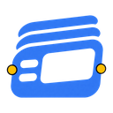

# NodeTake — Windows releases and user guides

NodeTake is a visual workspace for AI media creation, editing, and automation. **NodeTake Studio** is the canvas, **NodeTake Launcher** manages startup/setup, and **NodeTake Extension** connects supported websites through Chrome profiles.

[Windows downloads](https://github.com/Nodeforge-Studio/nodetake-releases/releases) · [Installation](docs/installation.md) · [User guide](docs/user-guide.md) · [Troubleshooting](docs/troubleshooting.md)

## Release transition

Published **v0.1.3** is the earlier **NodeForge** installer, retaining its original name and artwork. Current source has moved to NodeTake; a new branded installer has not yet been published. These manuals describe current NodeTake and identify transition differences. A README change does not add features to old binaries.

## Downloads and setup

This repository contains public installers and documentation, not private application source. Releases attach an installer, `.blockmap`, and `latest.yml` for the updater. Legacy assets keep their NodeForge filenames. Use the attached executable, not GitHub's source ZIP.

Follow the installer's folder wizard. Current NodeTake uses the Launcher for setup/activation before Studio. Browser providers use the [extension](chrome-extension/README.md) in each chosen Chrome profile. FFmpeg, optional runtimes/models, provider accounts, and credits have separate requirements.

Current NodeTake lets you choose to download updates from **Launcher → Updates**. Finish jobs before installing/restarting. The compatibility profile remains `%APPDATA%\nodeforge`; back up it and project/data directories.

New source-built installers include an offline manual at `resources/documentation/index.html`. The older public NodeForge v0.1.3 installer does not; read the linked manuals here.

## Safety and support

Download from official release pages. Unsigned builds may show unknown-publisher warnings; verify origin before running. Never share activation/API keys, cookies, or unredacted sessions. See [troubleshooting](docs/troubleshooting.md).

The historical organization spelling `Nodeforge-Studio` remains in the URL. The product family is **NodeTake**.
